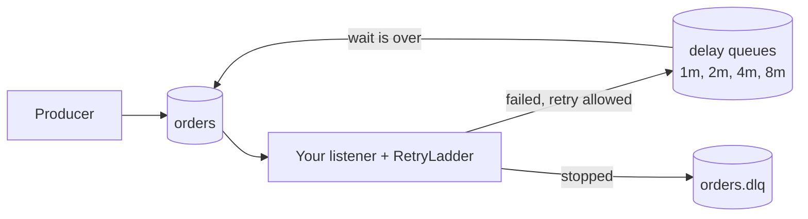

# rabbitmq-retry-ladder

**Who this is for:** Spring Boot teams whose RabbitMQ consumers need retries that wait in the broker, survive restarts, never lose a message, and leave an audit trail.

Spring Boot starter for loss-free RabbitMQ consumer retries with exponential backoff, a plateau and a time budget.

If you use Kafka, Spring already has `@RetryableTopic`. If you use RabbitMQ, there is no equivalent.
This library fills that gap, and adds a time budget and an audit trail.

> Status: built and tested. A showcase project, not published to Maven Central. Where it stands: [docs/00-status.md](docs/00-status.md). Design: [docs/02-design.md](docs/02-design.md).

## What it does

When a consumer fails, the message waits in a RabbitMQ delay queue (no thread sleeps), then comes back and is tried again.
The waits grow, then level off, and retries stop after a time budget:

```yaml
retry-ladder:
  initial-delay: 1m      # first wait
  multiplier: 2          # each wait × 2 (use 1 for a fixed delay)
  max-delay: 8m          # the plateau
  window: 30m            # stop 30 minutes after the first failure
  max-attempts: 100      # safety limit
  non-retryable: [com.example.InvalidPayloadException]   # park at once, don't retry
  queues:
    orders: {}           # uses the defaults above
    payments:
      window: 2h         # only this one changes
```

These values are also the defaults, so you only set what you want to change.
A queue name with dots goes in brackets: `"[notifications.delivery-status]": {}`.

This gives waits of 1m, 2m, 4m, 8m, then 8m repeating, until 30 minutes have passed.
The library logs this ladder at startup, so you can check your settings at a glance.

Every message carries its own history in headers: how many retries, when it first failed, when it last waited and for how long.
When it stops, it is parked in `<queue>.dlq` with the reason: `window`, `attempts` or `non-retryable`.

## Try it

You need only Docker:

```
docker compose --profile demo up --build --attach demo
```

This starts RabbitMQ (management UI on http://localhost:15672, guest / guest), builds the demo inside Docker and shows its log.

The demo's downstream is down for its first 20 seconds. You'll see a bad payment parked at once,
and an order retried after 2s, 4s, 8s and 8s, then processed. It was sent twice, so the repeat is skipped:

```
Message payment-1 parked in payments.dlq: queue=payments retryCount=0 reason=non-retryable
Retry scheduled: messageId=order-1 queue=orders retry=1 wait=2s elapsed=0ms ...
Retry scheduled: messageId=order-1 queue=orders retry=2 wait=4s elapsed=2066ms ...
Retry scheduled: messageId=order-1 queue=orders retry=3 wait=8s elapsed=6108ms ...
Retry scheduled: messageId=order-1 queue=orders retry=4 wait=8s elapsed=14143ms ...
Order order-1 processed: {"order":1,"item":"book"}
Order order-1 was already processed, skipping the repeat
```

Stop it with Ctrl+C, then `docker compose --profile demo down`.

With Java 25 installed, you can run the demo from Gradle instead: `docker compose up -d` starts only RabbitMQ,
then `./gradlew :demo:bootRun`.

## Use it

Call `RetryLadder.handle` from a listener in manual ack mode:

```java
@RabbitListener(queues = "orders", ackMode = "MANUAL")
public void onOrder(Message message, Channel channel) throws IOException {
    retryLadder.handle(message, channel, m -> orders.handle(m));
}
```

List the queue under `retry-ladder.queues`. At startup the library creates it, its parking queue
`orders.dlq` and the shared delay queues, so don't declare them yourself.
The `demo` module is a complete example.

## How it works



The details, with every failure case, are in [docs/02-design.md](docs/02-design.md).

## Settings

| Setting | Default | What it does |
|---|---|---|
| `retry-ladder.initial-delay` | `1m` | First wait after a failure |
| `retry-ladder.multiplier` | `2` | Each wait is the previous one times this. `1` means a fixed wait |
| `retry-ladder.max-delay` | `8m` | The waits stop growing here |
| `retry-ladder.window` | `30m` | Stop retrying this long after the first failure |
| `retry-ladder.max-attempts` | `100` | Safety limit on tries, used when the time limit can't be worked out |
| `retry-ladder.non-retryable` | none | Exception classes that can never succeed. A message failing with one is parked at once |
| `retry-ladder.queues.<name>` | none | The queues the library manages. Each can override the five wait settings above |
| `retry-ladder.queue-type` | `QUORUM` | Type of your own queues: `QUORUM` or `CLASSIC`. Delay and parking queues are always quorum |
| `retry-ladder.exchange-prefix` | `retry-ladder` | Name prefix for the exchanges and delay queues |
| `retry-ladder.confirm-timeout` | `5s` | How long to wait for RabbitMQ to confirm a retry copy or a parked message |

## Why not RabbitMQ's built-in delayed retry?

RabbitMQ 4.3 added a built-in delayed retry for quorum queues. It is simpler, and if it fits your case, use it.
This library is for cases where it doesn't fit, such as payments, banking alerts and anything audited:

| You need | RabbitMQ 4.3 built-in | This library |
|---|---|---|
| Exponential waits with a plateau (1m, 2m, 4m, 8m) | No: the wait grows linearly with the attempt count | Yes |
| Stop after a time budget ("30 minutes after the first failure") | No: it stops by attempt count only | Yes |
| Skip retries for errors that can never succeed | No | Yes, with reason `non-retryable` |
| An audit trail: first-failure time, each wait, why it stopped | Only a delivery count | Yes, in headers, metrics and logs |
| Works before RabbitMQ 4.3 | No | Yes, on RabbitMQ 4.x |

Use the built-in feature when a simple, attempt-based, linear retry is enough.
Why the broker holds retries at all (and not Resilience4j, Kafka or Redis): [decision 7](docs/03-decisions.md).

## Project layout

| Path | What it is |
|---|---|
| `README.md` | this page: what it is, how to use it, where things are |
| `docs/00-status.md` | where the project stands, open decisions, backlog |
| `docs/01-requirements.md` | what the library must do (R-1 to R-8) and the tests that prove it |
| `docs/02-design.md` | how it works: formula, stop rule, queues, flows, guarantees |
| `docs/03-decisions.md` | all design decisions in one table |
| `LICENSE` | Apache-2.0 |
| `.gitignore` | files git ignores |
| `build.gradle.kts`, `settings.gradle.kts` | the Gradle build |
| `gradlew`, `gradlew.bat`, `gradle/` | the Gradle wrapper and the pinned versions |
| `retry-ladder-spring-boot-starter/` | the library |
| `demo/` | an example app |
| `compose.yaml` | RabbitMQ, and the demo with `--profile demo` |
| `Dockerfile` | builds and runs the demo in Docker |
| `.dockerignore` | keeps local files out of the Docker build |
| `.github/workflows/` | CI: build and all tests on every pull request |

## Guarantees

- No message is lost while RabbitMQ is healthy. The original is acked only after RabbitMQ confirms its retry copy or parked copy.
- A message can arrive twice, so your handler must be safe to run twice. The demo's `OrderHandler` shows a simple way.
- No ordering: a retried message goes behind newer ones.
- No thread sleeps while a message waits.

The full list, with what it doesn't promise, is in [docs/02-design.md](docs/02-design.md), section 5.

Built with AI coding assistance under explicit guardrails; every change is reviewed and tested by the author.

Licensed under Apache-2.0.
