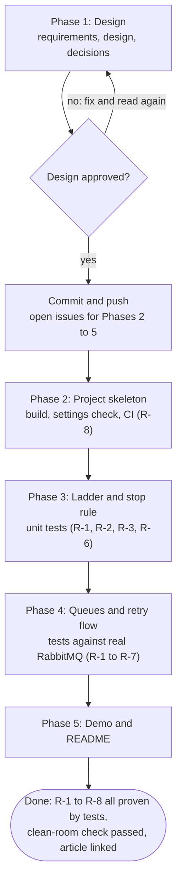
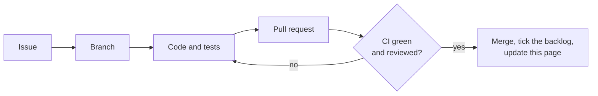

# Status

**Who this is for:** anyone who wants to know where this project stands, without reading the code.
**After reading:** you know what works today, what's being built, what's next, and what is still undecided.

Last updated: 2026-11-12 · Size: Small · Current phase: 5 of 5, waiting for the article link

## Where it stands

| Phase | What it delivers | Status |
|---|---|---|
| 1 | Design doc and decisions | ✅ approved 2026-11-10 |
| 2 | Project skeleton: Gradle build, Spring Boot auto-configuration, CI, a smoke test against real RabbitMQ | ✅ merged 2026-11-10 |
| 3 | The ladder and the stop rule, as plain logic with unit tests | ✅ merged 2026-11-11 |
| 4 | Queues, the retry flow and metrics, tested against real RabbitMQ | ✅ merged 2026-11-11 |
| 5 | Demo app, README and diagram | ✅ merged 2026-11-12 (article link still to add, #4) |

### The road to done

### How each phase is built

## What works today

Messages are retried in RabbitMQ: the waits grow, then level off. A message is parked when its time runs out, when it never succeeds,
or when its copy can't be stored. Tested against RabbitMQ 4.1 (R-1 to R-8).
The demo shows it: a bad payment is parked at once, and an order is retried until its downstream is back, then processed once.

## In progress

Nothing. The code is done.

## Next

1. Add the related article link when it's published (#4 stays open until then).

## Open decisions

None. Decided on 2026-11-12:

- A message moved back from the parking queue starts a fresh history ([decision 10](03-decisions.md)).
- An `Error` from the app's code parks the message instead of stopping the app ([decision 11](03-decisions.md)).
- A `window` shorter than `initial-delay` stops startup ([decision 12](03-decisions.md)).
- Messages parked after an `Error` have their own counter, `work_errors` ([decision 13](03-decisions.md)).

Decided on 2026-11-09:

- Errors that can never succeed skip the retries (R-3, [decision 5](03-decisions.md)).
- The README explains when RabbitMQ 4.3's built-in delayed retry is the better choice, and why this library suits
  time budgets, exponential backoff and audited systems ([decision 4](03-decisions.md)).
- Added the retry timeline: headers, a log line per retry and the ladder logged at startup (R-6 to R-8).

## Backlog

- [ ] Add the related article link (#4)

All phases are done. Their ticked checklists, and the review fixes, are in
[this file as of 2026-11-12](https://github.com/mushfika-faria-nova/rabbitmq-retry-ladder/blob/3d2611d/docs/00-status.md#backlog).

### Later ideas
- Compare with RabbitMQ 4.3's built-in delayed retry once both run.
- Also reset the history of a replayed message that RabbitMQ parked itself, using its `x-death` header (needs a broker test first).

## Not built yet / known limits

- Delivery is at least once: a message can arrive twice, so handlers must be safe to run twice.
- No ordering guarantee: a retried message goes behind newer ones.
- The time window is a scheduling deadline, not an execution deadline (see the design, section 2).
