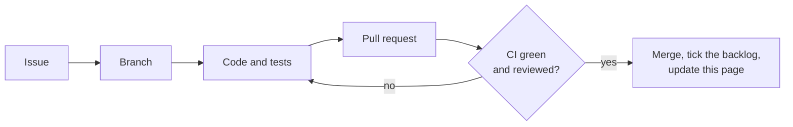

# Status

**Who this is for:** anyone who wants to know where this project stands, without reading the code.
**After reading:** you know what works today, what's being built, what's next, and what is still undecided.

Last updated: 2026-11-12 · Size: Small · Current phase: 5 of 5, waiting for the article link

## Where it stands

| Phase | What it delivers | Status |
|---|---|---|
| 1 | Design doc and decisions | ✅ approved 2026-11-10 |
| 2 | Project skeleton: Gradle build, Spring Boot auto-configuration, CI, a smoke test against real RabbitMQ | ✅ merged 2026-11-10 |
| 3 | The ladder and the stop rule, as plain logic with unit tests | ✅ merged 2026-11-11 |
| 4 | Queues, the retry flow and metrics, tested against real RabbitMQ | ✅ merged 2026-11-11 |
| 5 | Demo app, README and diagram | ✅ merged 2026-11-12 (article link still to add, #4) |

### The road to done

### How each phase is built

## What works today

Messages are retried in RabbitMQ: the waits grow, then level off. A message is parked when its time runs out, when it never succeeds,
or when its copy can't be stored. Tested against RabbitMQ 4.1 (R-1 to R-8).
The demo shows it: a bad payment is parked at once, and an order is retried until its downstream is back, then processed once.

## In progress

Fixes from a code review of the whole repo (pull request).

## Next

1. Add the related article link when it's published (#4 stays open until then).

## Open decisions

None. Decided on 2026-11-12:

- A message moved back from the parking queue starts a fresh history ([decision 10](03-decisions.md)).
- An `Error` from the app's code parks the message instead of stopping the app ([decision 11](03-decisions.md)).
- A `window` shorter than `initial-delay` stops startup ([decision 12](03-decisions.md)).

Decided on 2026-11-09:

- Errors that can never succeed skip the retries (R-3, [decision 5](03-decisions.md)).
- The README explains when RabbitMQ 4.3's built-in delayed retry is the better choice, and why this library suits
  time budgets, exponential backoff and audited systems ([decision 4](03-decisions.md)).
- Added the retry timeline: headers, a log line per retry and the ladder logged at startup (R-6 to R-8).

## Backlog

Each phase is one pull request. Tick a box when it's done.

### Phase 1: Design
- [x] Requirements (R-1 to R-8)
- [x] Design doc
- [x] Decisions table (8 decisions)
- [x] Rewrite 02-design.md in plain words
- [x] Check the design against Spring Boot 4 and Spring AMQP 4
- [x] Final read and approval
- [x] Mark all decisions Accepted, mark Phase 1 done
- [x] Commit and push
- [x] Open one GitHub issue for each of Phases 2 to 5

### Phase 2: Project skeleton
- [x] Gradle build (Kotlin DSL, Gradle 9.1+, Java 25) with two modules: `retry-ladder-spring-boot-starter` and `demo`
- [x] Pin the Spring Boot 4.x version and the RabbitMQ test image
- [x] Spring Boot auto-configuration with `@ConfigurationProperties`
- [x] Bad settings stop startup (R-8)
- [x] Print the retry plan for each queue at startup (R-8)
- [x] `compose.yaml` with RabbitMQ and its management UI
- [x] Smoke test against real RabbitMQ: declare the queues, check our headers survive the move back (decision 1)
- [x] CI on GitHub Actions: build and run all tests on every pull request

### Phase 3: Ladder and stop rule (plain logic, unit tests)
- [x] Waits grow, then level off; a fixed wait uses one queue; settings that need too many queues stop startup (R-1)
- [x] Time limit: a retry landing exactly on the limit is allowed, 1 ms over is not (R-2)
- [x] A message without its start time uses the try limit instead (R-2)
- [x] Errors that can never succeed, also when wrapped, are parked at once (R-3)
- [x] History headers on every retry copy and every parked message (R-6)

### Phase 4: Queues, retry flow and metrics (tests against real RabbitMQ)
- [x] Declare the delay queues, the return exchange, the bindings and the parking queues (decisions 1, 2, 4, 8)
- [x] Retry flow: store the copy, wait for "stored", then ack (decision 6)
- [x] Arrival time of each retry matches the plan (R-1)
- [x] A message out of time is parked with reason `window` (R-2)
- [x] A retry that can't be stored is parked, not lost (R-4)
- [x] A crash before the ack loses nothing (R-4)
- [x] Retried and parked messages are unchanged: body, properties, app headers (R-4)
- [x] No thread sleeps during a wait (R-5)
- [x] A retry planned before a restart arrives after it (R-5)
- [x] Two queues with different time limits share delay queues without affecting each other (R-5)
- [x] Counters, and one log line per retry with no message body (R-7)

### Phase 5: Demo and README
- [x] Demo app: a handler that fails for a while, then works; the logs show each retry
- [x] Demo's duplicate-safe handler: a message that finally works is processed once (R-4)
- [x] README: pitch, diagram, quick start, settings table, guarantees, and when RabbitMQ 4.3's own retry is the better choice
- [x] Clean-room check: no employer names, secrets, emails, IPs or hostnames
- [ ] Add the related article link

### Review fixes
- [x] An `Error` from the app's code parks the message; the listener keeps going (R-4, decision 11)
- [x] Retry and parked copies keep the delivery mode, and ignore changes the app's code made to the message (R-4)
- [x] A replayed message starts a fresh history (R-2, decision 10)
- [x] A broken start time on the first failure is replaced (R-2)
- [x] Startup refuses a `max-delay` of 24 days or more, and a `window` shorter than `initial-delay` (R-8, decision 12)
- [x] A multiplier just above 1 fails fast at startup instead of hanging (R-1)
- [x] Demo: an order without a `messageId` is parked at once

### Later ideas
- Compare with RabbitMQ 4.3's built-in delayed retry once both run.
- Also reset the history of a replayed message that RabbitMQ parked itself, using its `x-death` header (needs a broker test first).

## Not built yet / known limits

- Delivery is at least once: a message can arrive twice, so handlers must be safe to run twice.
- No ordering guarantee: a retried message goes behind newer ones.
- The time window is a scheduling deadline, not an execution deadline (see the design, section 2).
