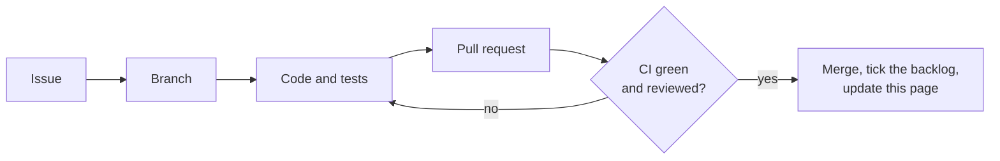

# Status

**Who this is for:** anyone who wants to know where this project stands, without reading the code.
**After reading:** you know what works today, what's being built, what's next, and what is still undecided.

Last updated: 2026-11-10 · Size: Small · Current phase: 2 of 5, project skeleton

## Where it stands

| Phase | What it delivers | Status |
|---|---|---|
| 1 | Design doc and decisions | ✅ approved 2026-11-10 |
| 2 | Project skeleton: Gradle build, Spring Boot auto-configuration, CI, a smoke test against real RabbitMQ | ⬜ not started |
| 3 | The ladder and the stop rule, as plain logic with unit tests | ⬜ not started |
| 4 | Queues, the retry flow and metrics, tested against real RabbitMQ | ⬜ not started |
| 5 | Demo app, README and diagram | ⬜ not started |

### The road to done

### How each phase is built

## What works today

Nothing runs yet. The design is approved; there is no Java code.

## In progress

Nothing yet. The approved design: the [requirements](01-requirements.md), the [design](02-design.md) and the [decisions](03-decisions.md).

## Next

1. Open one GitHub issue for each of Phases 2 to 5.
2. Build the project skeleton (Phase 2).

## Open decisions

None. Decided on 2026-11-09:

- Errors that can never succeed skip the retries (R-3, [decision 5](03-decisions.md)).
- The README explains when RabbitMQ 4.3's built-in delayed retry is the better choice, and why this library suits
  time budgets, exponential backoff and audited systems ([decision 4](03-decisions.md)).
- Added the retry timeline: headers, a log line per retry and the ladder logged at startup (R-6 to R-8).

## Backlog

Each phase is one pull request. Tick a box when it's done.

### Phase 1: Design
- [x] Requirements (R-1 to R-8)
- [x] Design doc
- [x] Decisions table (8 decisions)
- [x] Rewrite 02-design.md in plain words
- [x] Check the design against Spring Boot 4 and Spring AMQP 4
- [x] Final read and approval
- [x] Mark all decisions Accepted, mark Phase 1 done
- [ ] Commit and push
- [ ] Open one GitHub issue for each of Phases 2 to 5

### Phase 2: Project skeleton
- [ ] Gradle build (Kotlin DSL, Gradle 9.1+, Java 25) with two modules: `retry-ladder-spring-boot-starter` and `demo`
- [ ] Pin the Spring Boot 4.x version and the RabbitMQ test image
- [ ] Spring Boot auto-configuration with `@ConfigurationProperties`
- [ ] Bad settings stop startup (R-8)
- [ ] Print the retry plan for each queue at startup (R-8)
- [ ] `compose.yaml` with RabbitMQ and its management UI
- [ ] Smoke test against real RabbitMQ: declare the queues, check our headers survive the move back (decision 1)
- [ ] CI on GitHub Actions: build and run all tests on every pull request

### Phase 3: Ladder and stop rule (plain logic, unit tests)
- [ ] Waits grow, then level off; a fixed wait uses one queue; settings that need too many queues stop startup (R-1)
- [ ] Time limit: a retry landing exactly on the limit is allowed, 1 ms over is not (R-2)
- [ ] A message without its start time uses the try limit instead (R-2)
- [ ] Errors that can never succeed, also when wrapped, are parked at once (R-3)
- [ ] History headers on every retry copy and every parked message (R-6)

### Phase 4: Queues, retry flow and metrics (tests against real RabbitMQ)
- [ ] Declare the delay queues, the return exchange, the bindings and the parking queues (decisions 1, 2, 4, 8)
- [ ] Retry flow: store the copy, wait for "stored", then ack (decision 6)
- [ ] Arrival time of each retry matches the plan (R-1)
- [ ] A message out of time is parked with reason `window` (R-2)
- [ ] A retry that can't be stored is parked, not lost (R-4)
- [ ] A crash before the ack loses nothing (R-4)
- [ ] Retried and parked messages are unchanged: body, properties, app headers (R-4)
- [ ] No thread sleeps during a wait (R-5)
- [ ] A retry planned before a restart arrives after it (R-5)
- [ ] Two queues with different time limits share delay queues without affecting each other (R-5)
- [ ] Counters, and one log line per retry with no message body (R-7)

### Phase 5: Demo and README
- [ ] Demo app: a handler that fails for a while, then works; the logs show each retry
- [ ] Demo's duplicate-safe handler: a message that finally works is processed once (R-4)
- [ ] README: pitch, diagram, quick start, settings table, guarantees, and when RabbitMQ 4.3's own retry is the better choice
- [ ] Clean-room check: no employer names, secrets, emails, IPs or hostnames
- [ ] Add the related article link

### Later ideas
- Compare with RabbitMQ 4.3's built-in delayed retry once both run.

## Not built yet / known limits

- Delivery is at least once: a message can arrive twice, so handlers must be safe to run twice.
- No ordering guarantee: a retried message goes behind newer ones.
- The time window is a scheduling deadline, not an execution deadline (see the design, section 2).
