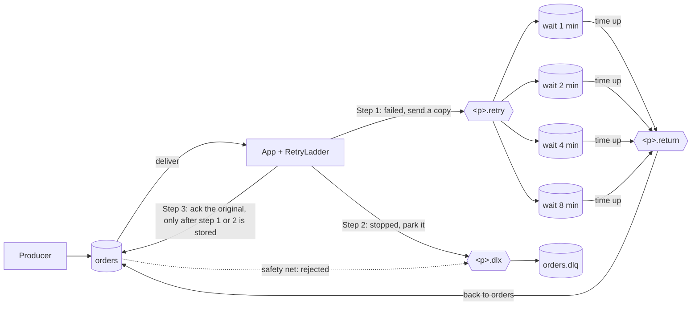

# Design: rabbitmq-retry-ladder

**Who this is for:** developers who build, review or use the library.
**After reading:** you know how each wait is worked out, when retries stop, which queues the library creates, what happens when something fails, and what it doesn't promise.

Status: **Accepted 2026-11-10.** Built in Phases 2 to 5.

Words used here: a **delay queue** is where a message waits before its next try. A **parking queue**
(`<queue>.dlq`) is where a message goes when it won't be retried any more. To **ack** a message is to tell
RabbitMQ "done, delete it".

The problem and the requirements are in [01-requirements.md](01-requirements.md).
The options we didn't pick, and why, are in [03-decisions.md](03-decisions.md).

## 1. How long each wait is (R-1)

```
wait = first wait × growth ^ (retries so far), but never more than the longest wait
```

**Example:** first wait 1 minute, growth 2, longest wait 8 minutes, time limit 30 minutes.

| Failure | Fails at | Wait | Next try at |
|---|---|---|---|
| 1 | 0 min | 1 min | 1 min |
| 2 | 1 min | 2 min | 3 min |
| 3 | 3 min | 4 min | 7 min |
| 4 | 7 min | 8 min | 15 min |
| 5 | 15 min | 8 min (stops growing) | 23 min |
| 6 | 23 min | 8 min would end at 31 min, past the limit | **parked, reason `window`** |

This assumes the app's code takes no time. The real time is measured from the first failure, so slow code
uses up the time limit too.

**Delay queues.** There is one queue for each different wait: here 1, 2, 4 and 8 minutes, so 4 queues.
More retries don't add queues. After the fourth, every retry uses the 8-minute queue.

- Growth 1 (a fixed wait): one queue.
- First wait equal to the longest wait: one queue.
- Settings that would need too many queues stop the app at startup, with a clear message.
- `max-delay` must be under 24 days. RabbitMQ holds a delay queue's wait as a whole number of milliseconds,
  and a longer wait doesn't fit.
- `window` must be at least `initial-delay`. A shorter window would park every failure at once (decision 12).

## 2. When retries stop (R-2, R-3)

Checked on every failure, in this order:

1. **An error that can never succeed.** The error, or one inside it, is on the `non-retryable` list:
   park now, reason `non-retryable` (decision 5).
2. **Too many tries.** `x-retry-count` has reached `max-attempts`: park, reason `attempts`.
3. **First failure.** No usable start time and no retries yet: write the time into `x-first-failed-at`.
4. **Time limit.** Retry only if the time since the first failure plus the next wait fits inside `window`.
   Landing exactly on the limit is allowed. 1 ms over is parked, reason `window`.
5. **Start time missing or broken** on a message that was already retried: the time can't be worked out.
   Log a warning and rely on rule 2 only. Don't write a new start time, or the clock would restart on every retry.

A missing or broken `x-retry-count` counts as 0. The time limit still applies.

**A replayed message** starts again (decision 10). Only a parked message has `x-retry-exhausted-reason`,
so a message that arrives with it was moved back from the parking queue after a fix. Before the checks above,
the library drops its old history headers. It then gets a new start time and the full time limit.
A message parked on its first failure still gets `x-first-failed-at`, so its history is complete.

`max-attempts` defaults to 100, so normally the time limit decides. It's only there in case a header is broken.

The time limit is checked when a retry is planned, not when it runs. If the app is paused or busy, a retry
planned just inside the limit can run after it. If it fails again, it's parked.

The clock is the app server's clock. Servers that share delay queues should keep their clocks in sync (NTP).
A clock difference shifts the limit a little. It never loses a message.

## 3. Queues and exchanges (R-1, R-5)

`<p>` is the name prefix, set with `retry-ladder.exchange-prefix` (default `retry-ladder`).



- `<p>.retry` (durable direct exchange): the app sends retry copies here. The routing key picks the delay queue.
- `<p>.delay.<ms>`: one quorum queue per wait, for example `retry-ladder.delay.60000` for 1 minute.
  When the time is up, RabbitMQ moves the message to `<p>.return` (decision 2).
- `<p>.return` (durable headers exchange): sends the message back to the queue named in `x-original-queue`.
  Each app queue is bound with `x-match=all-with-x`. Plain `all` skips headers that start with `x-`.
  The binding would then have nothing to check and would take every message, so each retry would land in
  every app queue (decision 1). The Phase 2 broker test proves both.
- `<p>.dlx` (durable direct exchange) and `<queue>.dlq` (quorum queue): one parking queue per app queue (decision 8).
- The library creates the app's queues too, so it can set where rejected messages go
  (`x-dead-letter-exchange=<p>.dlx`, `x-dead-letter-routing-key=<queue>.dlq`). If a queue already exists
  with different settings, RabbitMQ refuses at startup (`PRECONDITION_FAILED`). That's on purpose: better
  a loud failure than a silent one. The queue type is quorum by default; `retry-ladder.queue-type: CLASSIC` changes it.

Everything the library creates is durable, so it survives a RabbitMQ restart. Quorum queues are always
durable and save every message to disk, even one the sender marked as not persistent.

Headers the library adds: `x-retry-count`, `x-first-failed-at`, `x-original-queue`, `x-last-retry-at`,
`x-retry-delay-ms`, and when parked, `x-retry-exhausted-reason` and `x-exhausted-at`.

## 4. What happens in each case (R-4, R-6)

**It works.** The app's code finishes. The library acks. Done.

**It fails, and a retry is allowed.** The library makes a copy: same body, properties and `messageId`,
with the headers updated (retry count + 1, start time on the first failure). It sends the copy to the right
delay queue and waits up to `confirm-timeout` for RabbitMQ to say "stored". Then it acks the original.
When the wait is over, RabbitMQ sends the copy back to the app's queue and the app tries again.

The copy is made from the message as it arrived, so changes the app's code made to it don't reach the copy.
A persistent message stays persistent. Spring drops that setting when it receives a message, so the library
sets it again on the copy.

**The waits have stopped growing.** Same as above. The copy always goes to the longest-wait queue.

**Time limit reached, too many tries, or an error that never succeeds.** The library sends the original
message (same body, properties and `messageId`) to the parking queue with the reason (`window`, `attempts`
or `non-retryable`), waits for "stored", then acks the original.

**The copy isn't stored.** RabbitMQ sent it back (no queue took it), said no, or didn't answer in time.
The library doesn't ack. It rejects the original, and RabbitMQ moves it to the parking queue.
The `park_failed` counter goes up.
Putting it back would loop, and acking would lose it. Spring records a "sent back" before the "stored"
reply completes, so the check is safe. No answer in time is unclear (the copy may exist), so this case can
cause a duplicate.

A message parked this way has no `x-retry-exhausted-reason` header. RabbitMQ's `x-death` header shows it was
rejected, and the log and the `park_failed` counter show why.

**Parking fails too.** Same: reject. The queue's own dead-letter setting is the last safety net. That's why
quorum queues are the default (decision 2).

**The app's code throws an `Error`**, not an exception, for example an `AssertionError`. A retry could hit
the same bug. If the `Error` reached Spring, it would stop the listener, and by default the whole app.
So the library rejects the message, and RabbitMQ moves it to the parking queue. The `park_failed` counter
goes up with cause `work-error`. Only an `Error` that means the JVM itself is broken, such as running out of
memory, is passed on to Spring (decision 11).

**The app crashes before the ack.** RabbitMQ still has the original. When the connection closes, it
delivers it again with the same headers, so the count and the time limit don't change. If the crash came
after the copy was stored, both exist: a duplicate, never a loss.
Quorum queues also have a delivery limit (20 by default in RabbitMQ 4.x). A message that keeps crashing
the app is moved to the parking queue by RabbitMQ.

**The ack itself fails** (the connection closed): RabbitMQ delivers the message again. Same duplicate risk.

**A queue the library doesn't manage.** A failed message from a queue that isn't under `retry-ladder.queues` is rejected
and logged as an error. The library has no parking queue or return binding for it.

## 5. What it promises, and what it doesn't (R-4, R-5)

It promises:
- No message is lost while RabbitMQ is healthy. The original is acked only after its copy, or its parked
  message, is stored and not sent back. If that can't be proven, it's parked.
- Retries stop after a time limit, using a small, fixed number of delay queues.
- The retry state travels with the message. It survives restarts, and queues with different time limits
  can share delay queues.
- No thread sleeps while a message waits. The thread only waits for RabbitMQ's "stored" reply, up to
  `confirm-timeout` (normally a few milliseconds).

It doesn't promise:
- Exactly once. A message can arrive twice, so the app's code must be safe to run twice. The library
  doesn't remember which messages it has seen; the demo shows a simple way to do that.
- Order. A retried message goes behind newer ones.
- Exact timing. A wait is "not earlier than": it can be a little late. The time limit is checked when a
  retry is planned, not when it runs.
- To remove RabbitMQ's own `x-death` header, which RabbitMQ adds when it moves a message.
- Protection against changes by anyone with write access to RabbitMQ. Use RabbitMQ permissions, or sign
  the payload in the app.
- Safety if RabbitMQ itself loses data (a lost disk, classic queues on one server).
- Safety for non-persistent messages if you switch your own queue to classic. A classic queue keeps such
  a message only in memory, so a RabbitMQ restart loses it. Keep the default quorum queue, or send
  messages as persistent.

## 6. Test plan

The tests for each requirement are in the "Proven by" column of [01-requirements.md](01-requirements.md#what-it-must-do).
The backlog in [00-status.md](00-status.md) lists them by phase.

## 7. Counters and logs (R-7, R-8)

Counters:
- `retry_ladder_scheduled_total{queue,tier}`: retries planned. `tier` is the wait in ms.
- `retry_ladder_exhausted_total{queue,reason}`: messages parked.
- `retry_ladder_park_failed_total{queue,cause}`: copies or parked messages RabbitMQ didn't confirm, and
  messages rejected after an `Error` (cause `work-error`).

In Micrometer they are named `retry.ladder.scheduled`, `retry.ladder.exhausted` and `retry.ladder.park.failed`.
Prometheus shows them with the names above.

Logs:

| Level | When | What it shows |
|---|---|---|
| DEBUG (can be changed) | a retry is planned (INFO would be too noisy in an outage) | `messageId`, queue, retry number, wait, time so far, next try time, time left |
| INFO | once at startup, for each queue | the plan: waits, longest wait, time limit, max tries |
| WARN | a message is parked, or parking fails | `messageId`, queue, retry count, reason |
| ERROR | parking fails and RabbitMQ's own safety net is all that's left | same |

The message body is never logged, and no headers beyond these.
